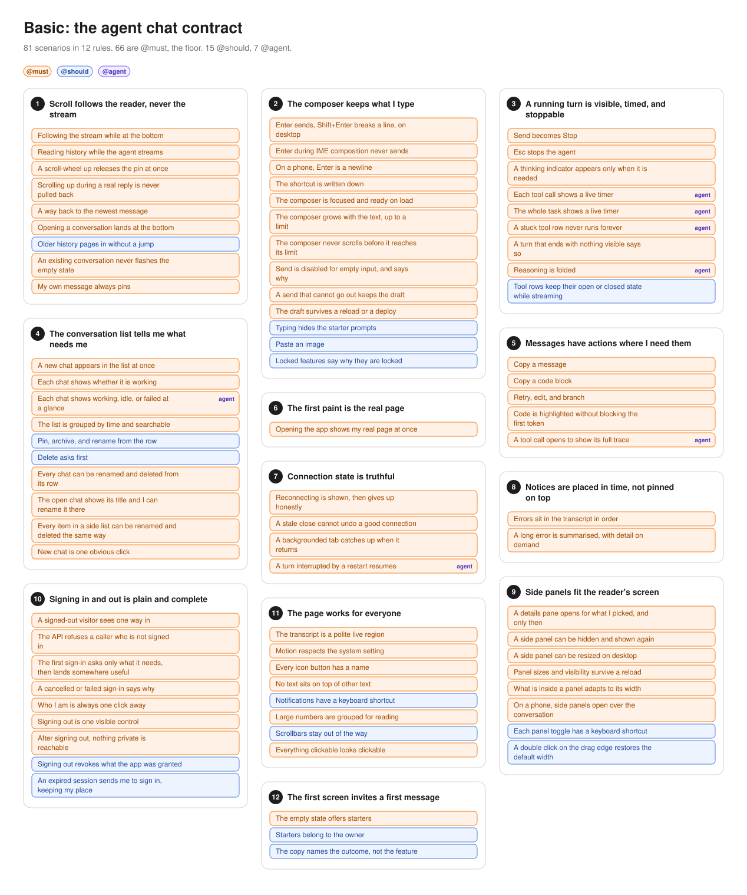
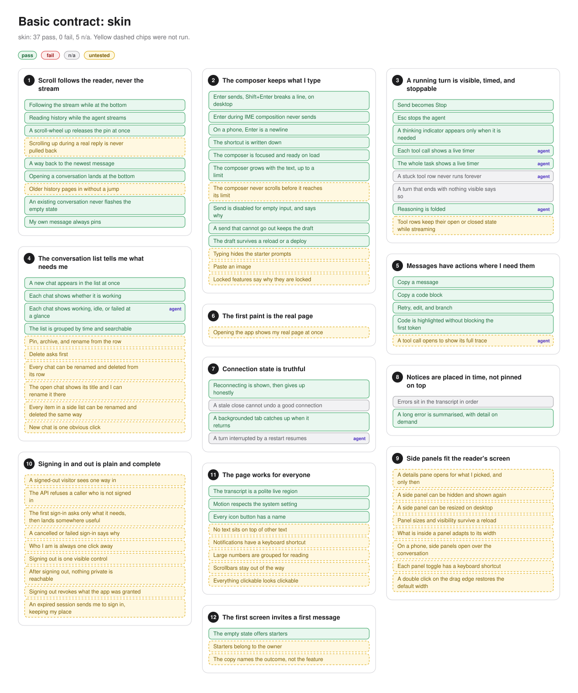

# Basic

Basic is a conformance suite for agent chat apps. It lists the behaviors every chat app must keep, written as Gherkin, and it comes with a runner that checks those behaviors in a real browser against a deployed app.

```sh
BASE=https://your.app node run.mjs --floor --app=<name>
```

The command exits 0 when every floor scenario either passes or has a written reason why it does not apply.

## What is here

| Path | What it is |
| --- | --- |
| `contract/chat.feature` | The contract: 12 rules and 81 scenarios. The 66 tagged `@must` are the floor. |
| `run.mjs` | Runs the scenarios in Chromium against `BASE` and writes `reports/<app>.md`. |
| `adapters/<app>.mjs` | Describes how to drive one app. There is one check for each scenario. |
| `reports/` | The most recent result for each app. `kernel-*.md` files come from static source probes (`kernel/`), not from a browser. |
| `app/` | `basic-reference`, the reference app that should pass the whole contract. It runs on Workers at `basic.customer0.dev`. `app/gate.mjs` is its production gate, and `.github/workflows/gate.yml` runs that gate. |
| `domain/` | Rules 3 and 4 written as an `@alchemy.run/domain` model, with in-memory stories and a mutation check. See `domain/RESULTS.md`. |
| `kernel/` | Static probes for server-side invariants T1 to T9 (owner, Durable Object state, payer, secrets, origin). |
| `diagrams/` | SVG maps of the contract, made by `diagram.mjs`. |
| `POST.md` | A draft post that explains where each scenario comes from. |

## Run

```sh
BASE=https://your.app node run.mjs --floor --app=skin
BASE=https://your.app node run.mjs --app=reference --rule="conversation list"
```

- `--floor` runs only the `@must` scenarios.
- `--rule=<words>` runs only the rules whose names contain those words. It prints the results and leaves the report unchanged.
- `--app=<name>` picks which `adapters/<name>.mjs` to use. Without it, the runner uses `skin`.

On the office network, an interstitial page intercepts `*.customer0.dev`, so every check against production fails at sign-in. You can either let the GitHub gate workflow run the checks, or run the reference app locally:

```sh
cd app
npm ci
npm run build
npx wrangler dev --port 8841
```

Then use `BASE=http://localhost:8841`.

## Adapters

Each scenario in an adapter has one of these values:

- A function that drives the page. It passes when it does not throw.
- An `n/a` reason string. The runner reports it as n/a, with that reason.
- A `MISSING: <why>` string. The runner counts it as a fail. Use it for checks that have not been written yet.

A check that returns `SKIPPED: <reason>` is reported as n/a, with that reason.

## Apps held to it

| App | Last run | Scope | Result |
| --- | --- | --- | --- |
| skin | 2026-10-14 | floor | 37 pass, 0 fail, 5 n/a |
| myax | 2026-10-19 | floor | 46 pass, 0 fail, 10 n/a |
| coil | 2026-10-18 | all | 30 pass, 12 fail, 28 n/a |
| reference | 2026-10-30 | all | 1 pass, 69 fail (run from the office network; see Run) |
| lab | 2026-11-19 | floor | 0 pass, 66 fail (adapter not written yet) |

`porch` has an adapter but no report yet. Porch mirrors Pi sessions and does not run turns itself, so many of its checks are n/a.

## The domain model

`domain/` checks Rules 3 and 4 without a browser. It is a standalone npm package:

```sh
cd domain
npm test
npm run typecheck
node scripts/mutate.mjs
```

- `npm test` runs 18 tests.
- `node scripts/mutate.mjs` applies 21 deliberate breaks, one at a time. Each break must fail at least one test.

`domain/src/rules/chatStatus.ts` is plain TypeScript. The model's `ChatList` view and the reference app's sidebar dot both import it, so the two cannot disagree about whether a chat is working, idle, failed or needs you.

## Diagrams

`node diagram.mjs` turns the Gherkin into SVG:

- `diagrams/contract.svg` shows every rule and scenario on one page, coloured by tag.
- `diagrams/rules/NN-<rule>.svg` has one page per rule. Each scenario is a row: Given, When, Then.
- `node diagram.mjs --app=skin` colours the same map using the results in `reports/skin.md`.



### The rules

1. [Scroll follows the reader, never the stream](diagrams/rules/01-scroll-follows-the-reader-never-the-stream.svg)
2. [The composer keeps what I type](diagrams/rules/02-the-composer-keeps-what-i-type.svg)
3. [A running turn is visible, timed, and stoppable](diagrams/rules/03-a-running-turn-is-visible-timed-and-stoppable.svg)
4. [The conversation list tells me what needs me](diagrams/rules/04-the-conversation-list-tells-me-what-needs-me.svg)
5. [Messages have actions where I need them](diagrams/rules/05-messages-have-actions-where-i-need-them.svg)
6. [The first paint is the real page](diagrams/rules/06-the-first-paint-is-the-real-page.svg)
7. [Connection state is truthful](diagrams/rules/07-connection-state-is-truthful.svg)
8. [Notices are placed in time, not pinned on top](diagrams/rules/08-notices-are-placed-in-time-not-pinned-on-top.svg)
9. [Side panels fit the reader's screen](diagrams/rules/09-side-panels-fit-the-readers-screen.svg)
10. [Signing in and out is plain and complete](diagrams/rules/10-signing-in-and-out-is-plain-and-complete.svg)
11. [The page works for everyone](diagrams/rules/11-the-page-works-for-everyone.svg)
12. [The first screen invites a first message](diagrams/rules/12-the-first-screen-invites-a-first-message.svg)

### skin, scored


