# Basic

A conformance suite for agent chat. The behaviors every chat app must keep, written as Gherkin, with a browser runner that checks a real deployment.

- `contract/chat.feature`: 52 scenarios. 42 are tagged `@must`: the floor.
- `run.mjs`: runs the scenarios against `BASE` in Chromium and writes `reports/<app>.md`.
- `adapters/<app>.mjs`: how one app is driven. A check is a function, an `n/a` reason string, or a `MISSING:` string that counts as a fail.
- `POST.md`: the draft post that explains where each scenario comes from.

## Diagrams

`node diagram.mjs` turns the Gherkin into SVG:

- `diagrams/contract.svg`: every rule and scenario on one page, coloured by tag.
- `diagrams/rules/NN-<rule>.svg`: one page per rule. Each scenario is a row: Given → When → Then.

`node diagram.mjs --app=skin` colours the same map by `reports/skin.md`: pass, fail, n/a, or not run.

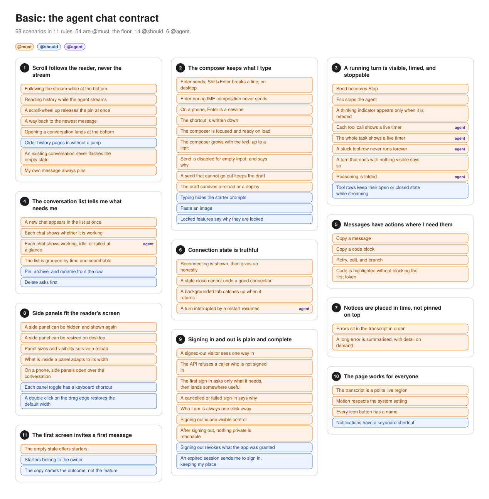

### skin, scored

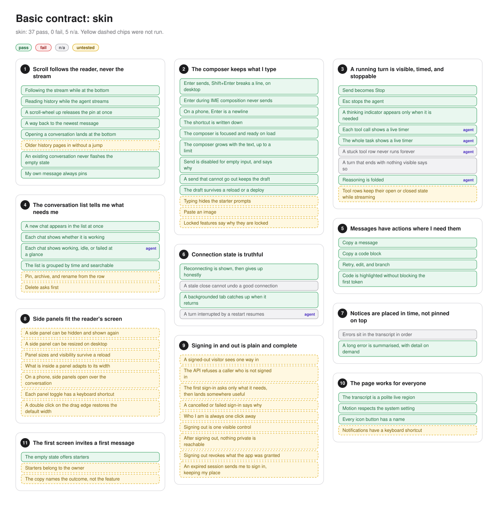

### 1. Scroll follows the reader never the stream

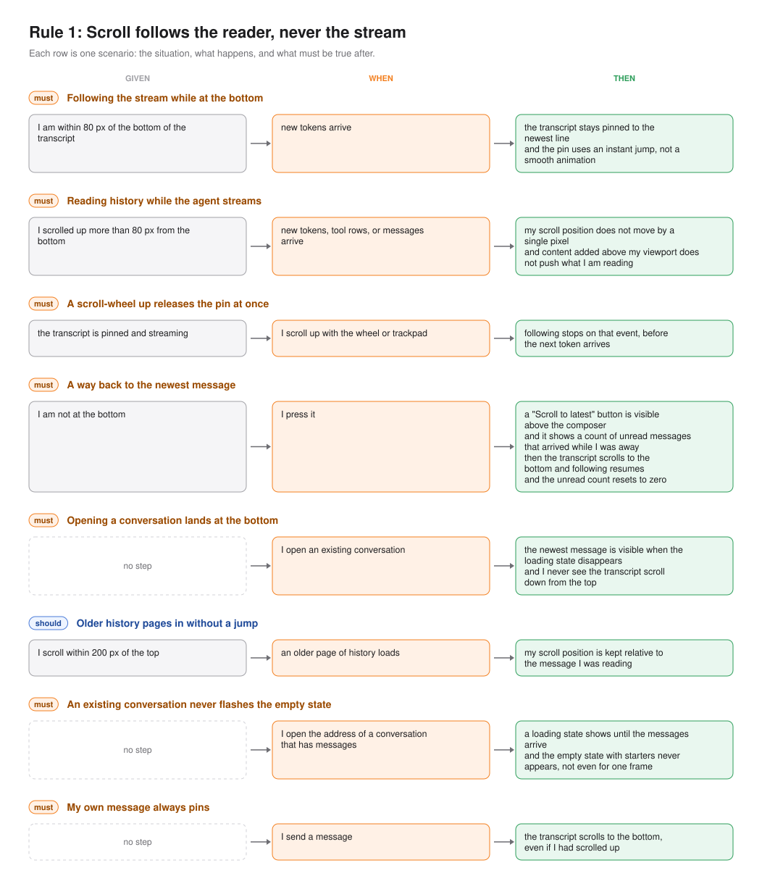

### 2. The composer keeps what i type

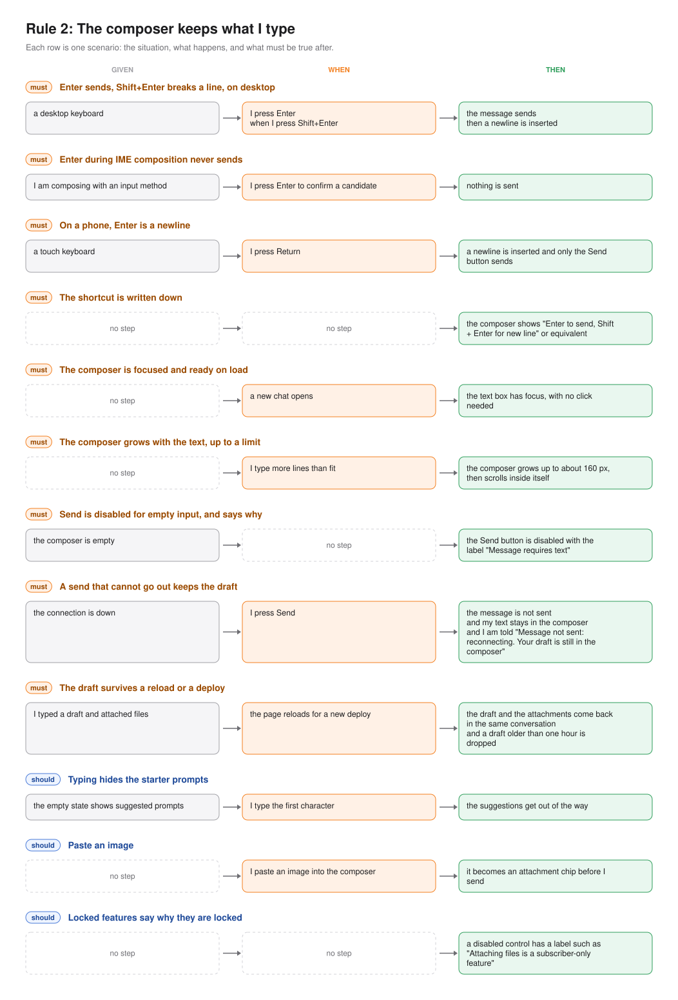

### 3. A running turn is visible timed and stoppable

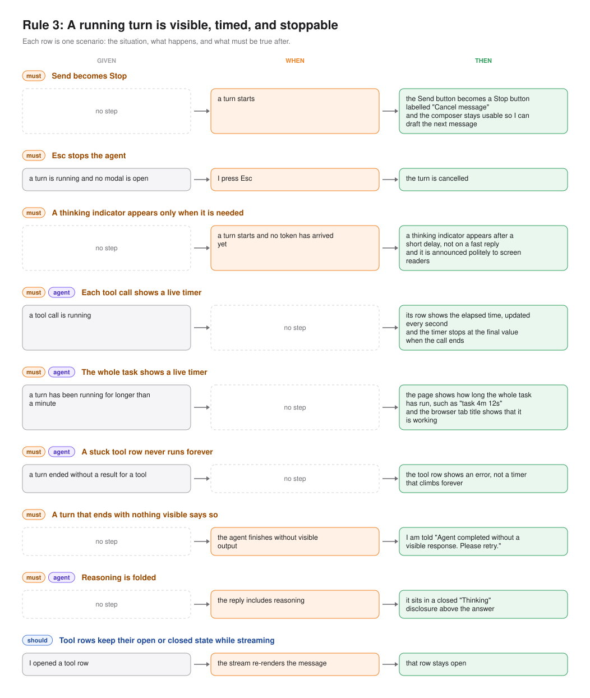

### 4. The conversation list tells me what needs me

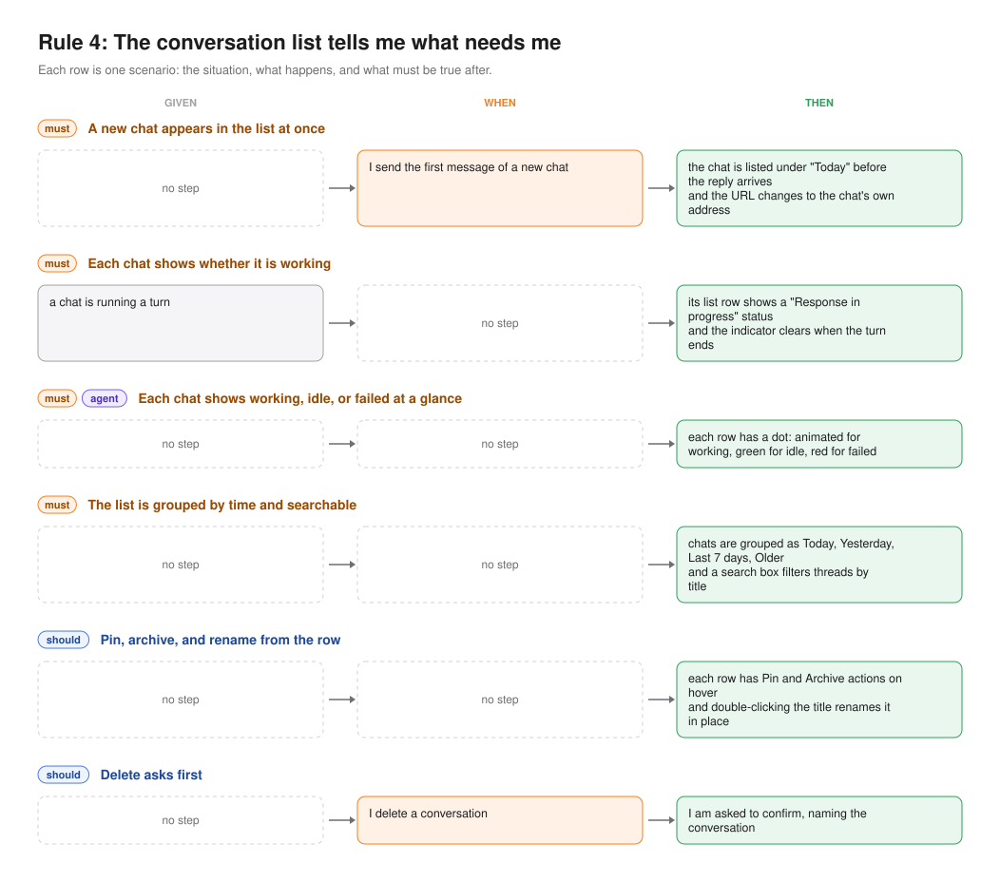

### 5. Messages have actions where i need them

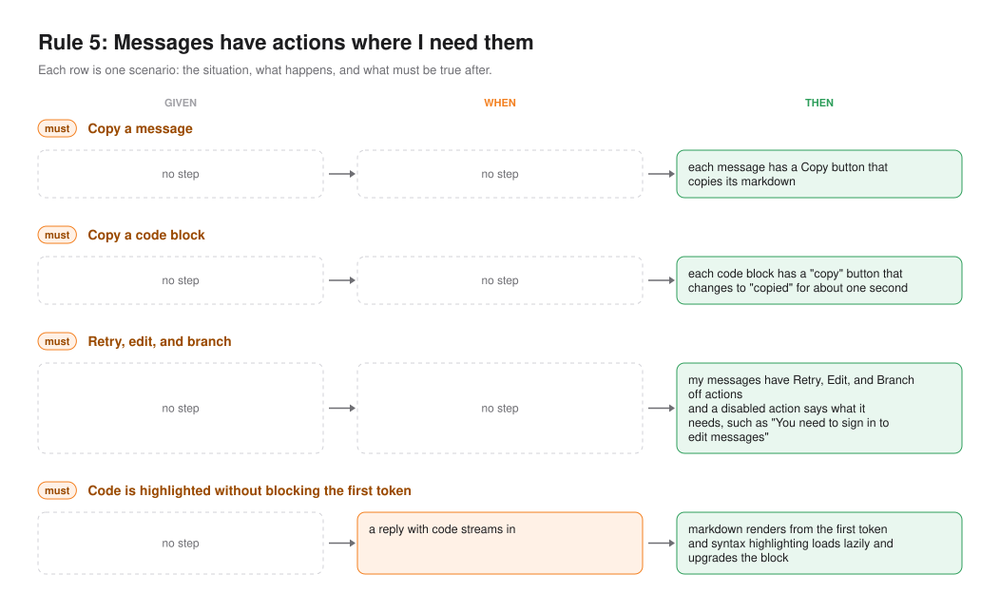

### 6. Connection state is truthful

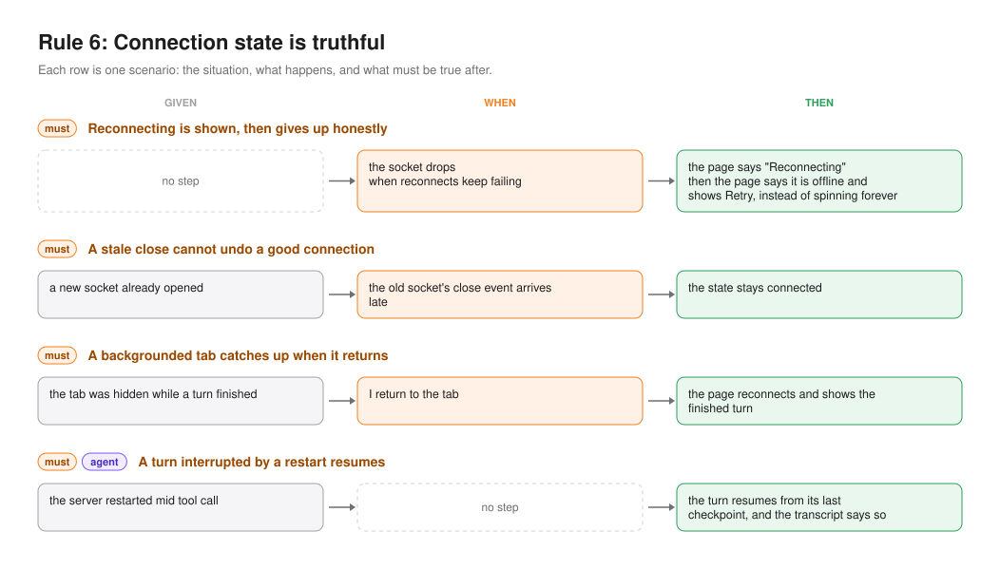

### 7. Notices are placed in time not pinned on top

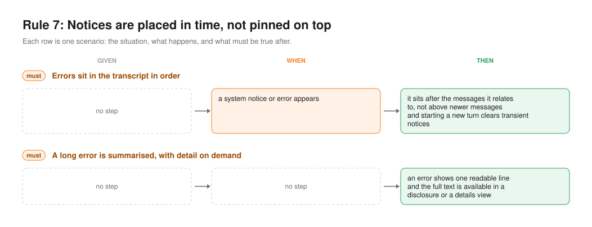

### 8. The page works for everyone

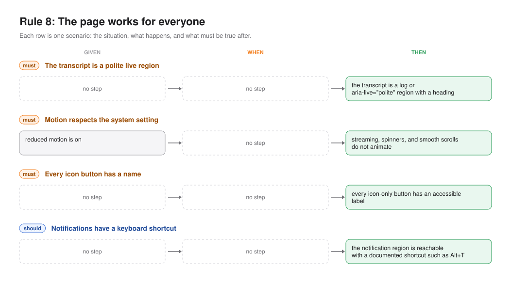

### 9. The first screen invites a first message

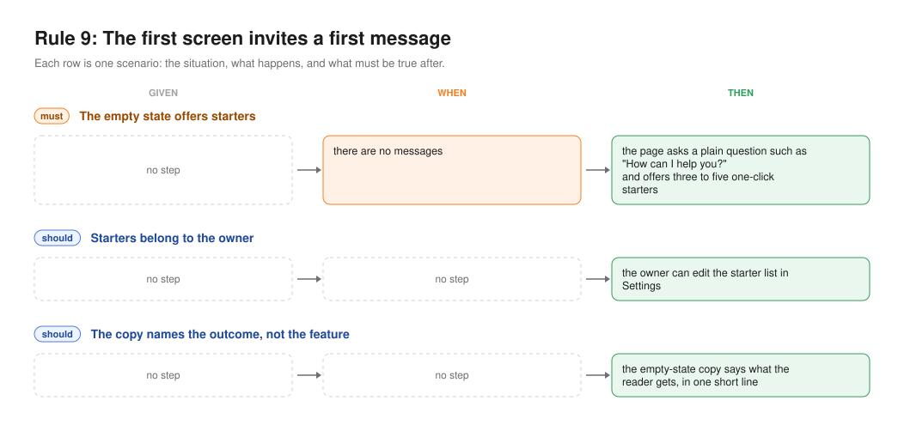

## Run

```sh
BASE=https://your.app node run.mjs --floor --app=skin
```

Exit code 0 means every floor scenario passed or has a written reason it does not apply.

## Apps held to it

| App | Floor | Report |
| --- | --- | --- |
| skin | 37 pass, 0 fail, 5 n/a | `reports/skin.md` |
